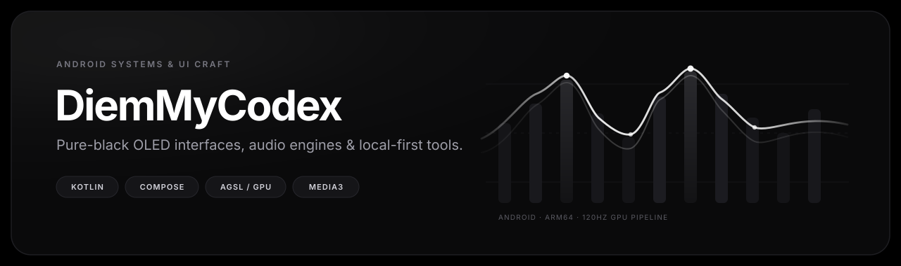

   
  Independent Android developer building pure-black OLED apps, 120Hz Jetpack Compose motion systems, and local-first audio &amp; terminal tools.
    
  

    
    
    
  

---

### Selected Work

| Project | Stack | Overview |
| --- | --- | --- |
| [**Onda-Music**](https://github.com/DiemMyCodex/Onda-Music) | `Kotlin` `Compose` `Media3` `AGSL` | Pure-black `#000000` OLED music player for Android with 10 Now Playing stages, 4-mode continuous 120Hz synced lyrics, 10-band parametric EQ with per-output device memory, and lossless Monochrome FLAC + YouTube Music playback. |
| [**NeoTerm**](https://github.com/DiemMyCodex/NeoTerm) | `Java` `Android` `GPL-3.0` | Liquid Glass terminal emulator for Android featuring floating pill sessions, live process status dots, and 4 synchronized themes. Fork of `termux/termux-app`. |

---

### Core Stack

| Layer | Technologies |
| --- | --- |
| **Android & UI** | Kotlin, Jetpack Compose, Material 3, AndroidX SplashScreen, Edge-to-Edge |
| **Graphics & Motion** | AGSL `RuntimeShader`, `RenderEffect` blur, GPU-only `graphicsLayer` choreography, critically-damped springs |
| **Audio & Data** | AndroidX Media3 / ExoPlayer, Jellyfin FFmpeg decoder, Room, DataStore, Hilt, Ktor, Coil 3 |
| **Workflow & CI** | Gradle Kotlin DSL, GitHub Actions ARM64 release pipelines, Termux ARM64 native workflows |

---

### Engineering Focus

- **Local-first by default** — zero ads, zero telemetry, portable offline backups, and full user control over data.
- **120Hz frame-budget craft** — deferred lambda animation reads, zero layout thrashing, and graceful `reducedMotion` fallbacks.
- **Tactile OLED minimalism** — pure `#000000` surfaces, intentional motion curves, and sharp typography.
